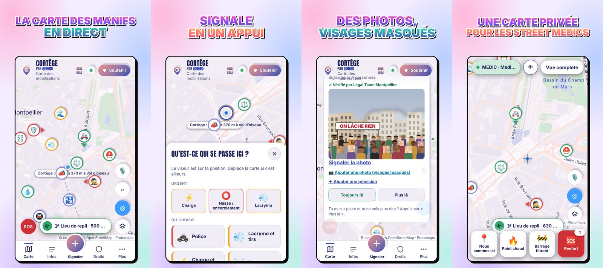

# Cortège

[](https://github.com/n-e-r-u/cortege/actions/workflows/tests.yml)
[](LICENSE)

**La carte des manifs en temps réel, tenue par celles et ceux qui y sont. Sans compte, sans pub, sans pistage.**

Pendant une manif, un blocus ou un rassemblement, chacun·e signale en deux appuis ce qui se passe (nasse, lacrymo, charge, street medics, legal team, zone calme…) et tout le monde le voit sur la carte en quelques secondes. Cortège est une appli web gratuite et libre, qui s'installe aussi sur Android.



| Tu veux… | Par ici |
|---|---|
| **T'en servir en manif** | [Ce que ça fait](#ce-que-ça-fait) · [Ta vie privée](#ta-vie-privée) |
| **Tenir la carte de ton cortège** (orga, syndicat, legal team, street medics) | [Pour les orgas et les street medics](#pour-les-orgas-les-legal-teams-et-les-street-medics) |
| **Ouvrir une carte** pour ta ville ou ton pays | [Héberger ta propre carte](#héberger-ta-propre-carte) |
| **Donner un coup de main** | [Participer](#participer) |

## Ce que ça fait

- 📍 **Signaler en deux appuis.** Charge, nasse, lacrymo : un seul appui. Pour le reste, une famille puis le type, avec le nombre de personnes et la direction si tu les connais. Les autres confirment (« Toujours là ») ou démentent (« Plus là »), et chaque point s'éteint seul au bout de quelques minutes.
- 📳 **Être prévenu·e.** Une vibration différente pour chaque danger proche, et des notifications même appli fermée : dangers dans ta zone, annonces urgentes des orgas.
- 📷 **Joindre une photo, visages masqués.** Toute photo passe par le Flouteur : les visages sont détectés et pixellisés sur le téléphone, la photo est réenregistrée sans position ni métadonnées. Elle n'est visible du public qu'une fois le point vérifié.
- 🎙️ **Garder une trace d'un contrôle.** L'enregistreur de son écrit par petits morceaux sur le téléphone : ce qui est pris reste, même si l'écran se verrouille ou si le téléphone s'éteint. Rien n'est envoyé.
- ⚖️ **Connaître ses droits.** Les réflexes en cas de contrôle ou d'interpellation, les numéros des legal teams de ta ville, un SMS d'alerte pré-rempli pour un proche.
- 📅 **Agenda.** Manifs, blocus, rassemblements et AG, avec le parcours sur la carte et les arrêtés d'interdiction en vigueur.
- 🏛 **Lieux utiles.** Lieux de repli ouverts par les orgas, points d'eau, défibrillateurs, urgences, pharmacies, préfectures, commissariats, tribunaux, lycées et facs.
- 📶 **Tenir quand le réseau sature.** Mode léger, signalements gardés jusqu'à ce que ça capte, dernière situation connue affichée hors ligne, carte gardée sur le téléphone. L'appli charge le strict nécessaire : ce qui sert rarement n'est téléchargé qu'à la demande.
- 🌍 **Plusieurs pays, plusieurs langues.** Français, anglais, espagnol, allemand et arabe ; un profil par pays pour les droits, les numéros d'urgence et les types de signalement.

## Pour les orgas, les legal teams et les street medics

- 📣 **Orgas et legal teams.** Annonces localisées autour du cortège, vérification des signalements et retrait des faux, rendez-vous dans l'agenda avec parcours et point de dispersion, point de ralliement, lieux de repli, position en direct (tête de cortège, legal team, presse), tableau de bord, affiche et flyers avec QR code.
- ⛑️ **Street medics.** Un écran à part et une carte privée entre équipes : positions, points chauds, barrages filtrants, appels de renfort. Elle vit en mémoire seulement, jamais dans la base ni dans les sauvegardes. [Guide des équipes](docs/MEDICS.md).
- 🔑 **Un accès sans mot de passe.** Invitation à usage unique (QR code ou lien), clé gardée sur le téléphone, code de secours pour retrouver un accès perdu, plusieurs appareils par orga ou par équipe.

Sur une instance, la page `/orgas` explique à un collectif ce qu'un accès permet et comment l'obtenir.

## Contre les faux signalements

- Un « Plus là » ne supprime jamais un point à lui seul. Il faut plusieurs votes, venant d'au moins deux réseaux différents, pour qu'un point devienne « contesté » : il est alors grisé et s'éteint au bout de quelques minutes, sauf si quelqu'un le confirme.
- Les votes n'ont pas tous le même poids : un vote fait près du point compte davantage, celui d'un téléphone apparu il y a quelques minutes compte moins, et les votes en rafale ne sont pas comptés. Un point déjà confirmé demande plus de votes.
- Un point vérifié par une orga ne peut pas être contesté par les votes. Les points contestés passent par la file de modération de l'admin, qui peut les rétablir.
- Les orgas entrent par invitation, avec une période d'essai ou un parrainage. Un accès révoqué coupe aussi les orgas que celle-ci a fait entrer.
- Une photo signalée par deux téléphones est cachée jusqu'à ce qu'une orga ou l'admin la remette ou la supprime.

Détails : [anti-abus](docs/FONCTIONNEMENT.md#anti-abus).

## Ta vie privée

- Ta position ne quitte jamais ton téléphone : seuls les signalements partent, arrondis à une dizaine de mètres.
- Aucun compte, aucun cookie, aucun traqueur. Aucune adresse IP n'est gardée en clair. Les signalements sont effacés à leur expiration.
- Une photo jointe à un signalement est effacée du serveur 3 jours après l'envoi, sauf si l'admin la garde pour un bilan public. Les enregistrements de son ne quittent pas le téléphone.
- La carte peut être servie par le serveur lui-même (aucune requête vers un fournisseur) et l'appli est joignable par Tor.
- Le code est public et n'est pas compressé : chacun·e peut vérifier que l'appli en ligne est bien celle de ce dépôt.

Détails : [ce que le serveur sait et ne sait pas](docs/FONCTIONNEMENT.md#ce-que-le-serveur-sait-et-ne-sait-pas) et [SECURITY.md](SECURITY.md).

## L'installer sur ton téléphone

- **Depuis le navigateur** : ouvre la carte, puis « Installer l'appli » (ou « Sur l'écran d'accueil » sur iPhone). Aucun store, aucun compte.
- **Sur Android** : une instance peut aussi publier son appli sur le Play Store. C'est une coquille officielle de Google (Trusted Web Activity) qui ouvre le site en plein écran, sans code ni outil de statistiques ajouté. [Construire et publier l'appli](docs/PLAY_STORE.md).

## Héberger ta propre carte

Cortège tourne sur un petit serveur (Node 22.13 ou plus, aucune dépendance à installer, base SQLite intégrée) ou sur un hébergement mutualisé avec cPanel :

```bash
node server.js   # puis ouvre http://localhost:8080
```

- [Installation et configuration](docs/INSTALLATION.md) : variables, VPS, cPanel, Docker, sauvegarde, carte hébergée, adresse .onion.
- [Ouvrir une instance dans un autre pays](docs/INSTANCE.md) : profil du pays, langues, ce qu'une instance doit garantir aux personnes qui l'utilisent.
- [Fonctionnement détaillé](docs/FONCTIONNEMENT.md) : signalements, anti-abus, administration, digest.
- [Organisation du code](ARCHITECTURE.md) et [nouveautés de chaque version](CHANGELOG.md).

## Participer

Pas besoin de savoir coder pour être utile :

- **Sur le terrain** : sers-t'en en manif et dis ce qui coince. Dans l'appli, Plus › Idées permet de proposer une amélioration et de voter pour celles des autres ; les idées retenues deviennent des [issues](../../issues).
- **Traduire** : un fichier par langue dans [`i18n/`](i18n/LISEZMOI.md), au format PO (Poedit, Weblate). Une nouvelle langue s'ajoute en déposant son fichier, sans toucher au code.
- **Adapter à ton pays** : droits en cas de contrôle, numéros d'urgence, types de signalement. Tout est dans un [profil de pays](docs/INSTANCE.md), relisible par des juristes et des legal teams.
- **Coder** : le code est en JavaScript sans framework ni dépendance, découpé en petits fichiers par fonction. [CONTRIBUTING.md](CONTRIBUTING.md) explique comment lancer l'appli, les tests et les règles du projet (la position ne quitte pas le téléphone, rien d'identifiant en clair, pensé pour un réseau saturé).
- **Une faille de sécurité** : voir [SECURITY.md](SECURITY.md), sans la publier.

Merci à celles et ceux qui ont déjà contribué, dont [MltStephane](https://github.com/MltStephane) (Flouteur) et [JadePrice](https://github.com/JadePrice) (audit et corrections) et [22eme-Arkane](https://github.com/22eme-Arkane) (signalements de sécurité, proposition de refonte de l’interface).

## Licence et crédits

Licence [AGPL-3.0](LICENSE) : toute version modifiée mise en ligne doit publier son code. Toute instance garde aussi la mention d'origine dans son interface : voir les [conditions additionnelles](LICENSE-ADDITIONAL-TERMS.md).

Données cartographiques © les contributeur·ices d'[OpenStreetMap](https://www.openstreetmap.org/copyright) (ODbL). Noms et positions des villes du digest : [GeoNames](https://www.geonames.org/) (CC BY 4.0), fichier `places.json`.
Polices des stories : Inter et JetBrains Mono (SIL Open Font License), dans `public/vendor/fonts/`. Rendu de la carte vectorielle : [protomaps-leaflet](https://github.com/protomaps/protomaps-leaflet) (BSD-3-Clause). Détection des visages du Flouteur : [MediaPipe](https://github.com/google-ai-edge/mediapipe) (Apache-2.0). Fond de carte des stories : Natural Earth via world-atlas (domaine public).
